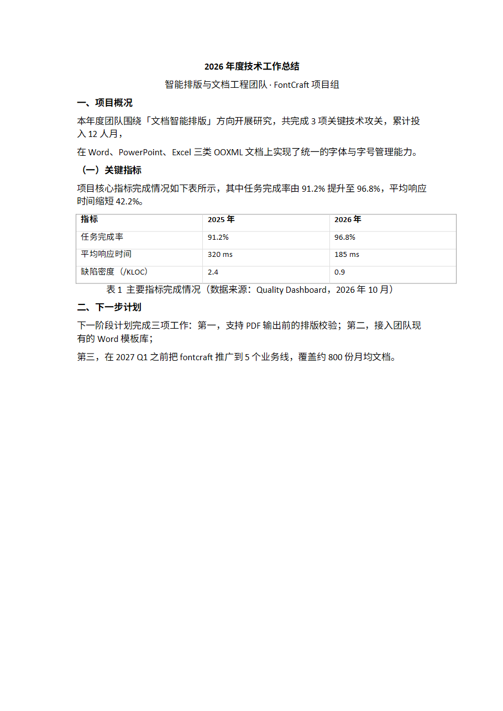
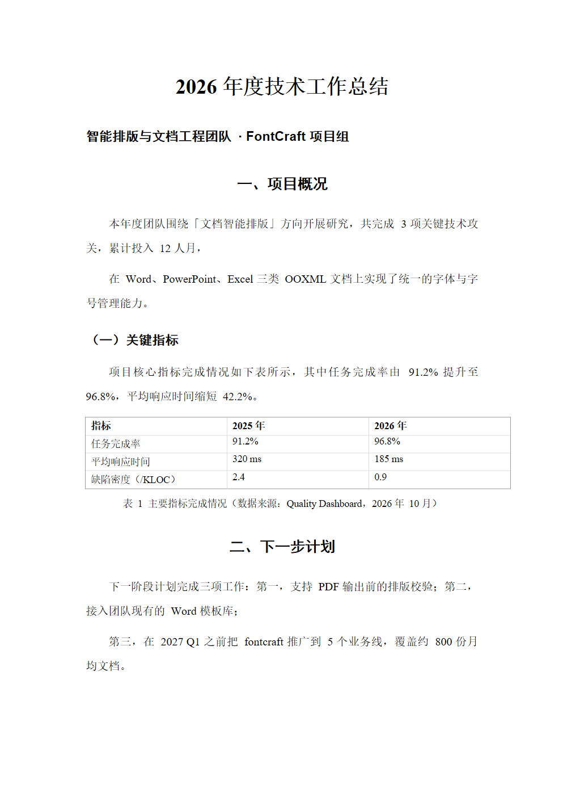

# fontcraft

给 [DeepSeek Harness](https://github.com/deepseek-ai/deepseek-harness) 用的排版插件：
**生成 Word / PPT / Excel 之前，先把标题、正文、数字、英文等各类文字的字体和字号选好，实时预览，确认后文档自动套用。**

中文排版里最麻烦的那件事——「中文宋体、英文和数字 Times New Roman、标题黑体、正文小四」——
现在是一个可以点选的面板，而不是每次在提示词里写一遍。




左图是默认 Calibri 的样子；右图套用了内置的「中文论文（标准）」：标题黑体三号、正文宋体小四、
英文与数字 Times New Roman、1.5 倍行距、首行缩进 2 字符，表格与图表注用独立字号。

可对照打开：[examples/demo-before.docx](examples/demo-before.docx) · [examples/demo-after.docx](examples/demo-after.docx)

## 特性

- **按文字类别选字体**：中文、英文、数字可以各用不同字体（这是中文排版的关键）。
- **按文字角色设格式**：封面标题、一/二/三级标题、正文、图表注、表格、页眉页脚、代码，
  每个角色的字号、加粗、对齐、行距、段前段后、首行缩进都能单独调，也能覆盖自己的中/英/数字字体。
- **实时预览**：面板右侧用你选的字体字号直接渲染样张。
- **四种内置方案**：中文论文、党政机关公文（GB/T 9704）、现代商务、工作总结。
- **三种格式**：`.docx`、`.pptx`、`.xlsx`。
- **给 AI 的工具**：`fontcraft` 工具（`list / get / use / save / apply / audit`）+ 系统提示 + 技能，
  模型生成完文档会自动套用并报告实际字体。
- **零依赖引擎**：自带 zip 读写与 XML DOM，只用 Node 内置模块；不装 python-docx、不装 LibreOffice。

## 安装

前置：已经能用 `dsh web` 启动 DeepSeek Harness（>= 0.2.1），Node.js >= 18。

1. **克隆到本地**

   ```powershell
   git clone https://github.com/<your-name>/fontcraft.git D:\fontcraft
   ```

2. **把包装进 DSH 的 web profile**

   让 profile 的 `node_modules` 里有一个指向本仓库的链接（Windows 用目录联接，macOS/Linux 用软链）：

   ```powershell
   # Windows
   New-Item -ItemType Directory -Force "$env:USERPROFILE\.dsh\profiles\web\node_modules" | Out-Null
   New-Item -ItemType Junction -Path "$env:USERPROFILE\.dsh\profiles\web\node_modules\fontcraft" -Target D:\fontcraft
   ```

   ```bash
   # macOS / Linux
   mkdir -p ~/.dsh/profiles/web/node_modules
   ln -s /path/to/fontcraft ~/.dsh/profiles/web/node_modules/fontcraft
   ```

   > 也可以用官方的插件管理器：`dsh plugin --profile web add link:D:\fontcraft`。

3. **在 profile 的补丁层里启用**

   编辑 `~/.dsh/profiles/web/cordis.patch.yml`，在末尾追加：

   ```yaml
   - insert:
       - id: fontcraft
         name: fontcraft
   ```

4. **重启并刷新**

   重启 `dsh web`，然后刷新浏览器页面。输入框左侧会出现 **`Aa 排版`** 按钮。

> 之后改 `lib/client.js`（界面）刷新页面即可；改 `lib/index.js` 或 `engine/*`（主机代码）需要重启 `dsh web`。

### 卸载

删掉 `cordis.patch.yml` 里的 `insert` 段，再删掉 profile 的 `node_modules/fontcraft` 链接即可。

## 使用

### 面板

1. 点输入框左侧的 `Aa 排版`。
2. `文字类别字体` 选中文 / 英文 / 数字字体；`文字角色样式` 逐项调字号与段落格式。
3. 点「保存并应用」，之后正常让 AI 生成文档，工具会自动套用。

### 对话里直接说

> 用「党政机关公文」那套排版，帮我写一份关于年度安全巡检的报告。

模型会调用 `fontcraft` 工具切换方案、生成文档、套用字体，并用 `audit` 核对结果。

### 工具接口

| action | 说明 |
|---|---|
| `list` | 列出全部方案与当前方案 |
| `get` | 打印当前（或指定）方案的字体与字号 |
| `use` | 切换当前方案，`scheme` 传方案 id 或名称 |
| `save` | 保存新方案，`scheme` 传方案 JSON |
| `apply` | 把方案套用到 `files` 里的文档（`output` 可另存） |
| `audit` | 检查文档里实际出现的字体与字号 |

### 内置方案

| id | 名称 | 特点 |
|---|---|---|
| `cn-paper` | 中文论文（标准） | 标题黑体、正文宋体小四、英文数字 Times New Roman、1.5 倍行距、首行缩进 2 字符 |
| `cn-gov` | 党政机关公文（GB/T 9704） | 标题方正小标宋二号、正文仿宋三号、固定行距 28 磅 |
| `modern-sans` | 现代商务（无衬线） | 微软雅黑 + Calibri，标题加粗 |
| `cn-official-report` | 工作总结（宋体正文） | 正文宋体三号、数字用 Arial |

自定义方案保存在 `~/.dsh/fontcraft/fontcraft.json`。

## 方案的数据结构

方案分两层：**文字类别**决定字体，**文字角色**决定字号与段落格式，角色可以覆盖字体。

```json
{
  "id": "cn-paper",
  "name": "中文论文（标准）",
  "scripts": {
    "cjk":   { "font": "宋体" },
    "latin": { "font": "Times New Roman" },
    "digit": { "font": "Times New Roman" }
  },
  "roles": {
    "title1": {
      "size": 16, "bold": true, "align": "center",
      "spaceBefore": 12, "spaceAfter": 12,
      "font": { "cjk": "黑体", "latin": "Arial", "digit": "Arial" }
    },
    "body": {
      "size": 12, "align": "justify",
      "lineSpacing": { "mode": "multiple", "value": 1.5 },
      "firstLineIndent": 2
    }
  }
}
```

- `lineSpacing.mode`：`multiple`（倍数）或 `exact`（固定值，单位 pt）
- `firstLineIndent`：字符数
- `spaceBefore` / `spaceAfter`：pt
- 字段缺省表示「保持原样」，不会强行改写文档

## 支持矩阵

| 格式 | 角色判定 | 字体 | 段落格式 | 备注 |
|---|---|---|---|---|
| `.docx` | 样式名（Title / Heading 1-3 / Caption）、大纲级别、是否在表格内 | `w:ascii` / `w:hAnsi` / `w:eastAsia` / `w:cs`，按字符切分 run | 对齐、行距、段前段后、首行缩进、styles.xml 同步 | 页眉页脚单独处理 |
| `.pptx` | 占位符类型（title / body / ftr…）、表格 | `a:latin` / `a:ea` / `a:cs`、`sz`、`b` | 对齐、行距 | 幻灯片、版式、母版 |
| `.xlsx` | 表头行（文本行 + 下一行有数字）与普通单元格 | 新增 `font` 并克隆 `cellXfs` | 仅字体与加粗 | 单元格粒度，保留数字格式/边框/填充 |

## 工作原理

排版引擎是**后处理**：解包 OOXML（zip + XML），按角色与文字类别重写 run 属性，再重新打包。
好处是与生成方式解耦——python-docx、python-pptx、openpyxl 生成的文档，或者用户自己的文档，都能套用。

中文与西文用的是同一段文本里的不同 `w:rFonts` 属性；要让**数字和英文用不同字体**，
Word 里必须把 run 拆开（引擎会按字符类别切分），这也是很多「一键排版」工具做不到的地方。

```
lib/index.js     主机插件：agent 工具、/fontcraft/api/*、系统提示、技能
lib/client.js    浏览器插件：输入框按钮、面板、实时预览
engine/zip.js    自带的 zip 读写（node:zlib）
engine/xml.js    保留命名空间与属性的轻量 XML DOM
engine/docx.js   docx 排版
engine/pptx.js   pptx 排版
engine/xlsx.js   xlsx 排版
engine/fonts.js  枚举本机字体（Windows 注册表）
docs/design.md   设计草案
```

## 开发

```bash
npm test          # 主机插件 + 浏览器 bundle + pptx/xlsx 引擎
npm run demo      # 生成 examples/demo-before.docx
```

docx 的视觉验收（可选，需要 DSH 自带的 LibreOfficeKit）：

```bash
node scripts/render-docx.mjs examples/demo-after.docx render/after
```

## 已知限制

- **Excel**：一个单元格只能一种字体，混合内容的单元格会按「含中文 → 中文字体，否则 → 英文/数字字体」选择；
  暂不支持富文本共享字符串。
- **PowerPoint**：只处理幻灯片、版式、母版里的文本与表格，图表（chart）里的文字暂不处理。
- **预览**是浏览器字体渲染的近似效果，最终以 Word / PowerPoint 打开为准。
- 部分公文字体（如「方正小标宋简体」）需要本机安装，否则会被替换成系统默认字体。
- Word 与 LibreOffice 对表格行高、CJK 字距的处理略有差异，跨软件排版需实测。

## Roadmap

- [ ] PDF 导出前的排版校验
- [ ] 从 Word 模板反读方案（「按这个文档的样式建一套方案」）
- [ ] PPT 图表文字、Excel 富文本单元格
- [ ] 方案导入 / 导出（`.fontcraft.json`）

## 许可证

[MIT](LICENSE)
